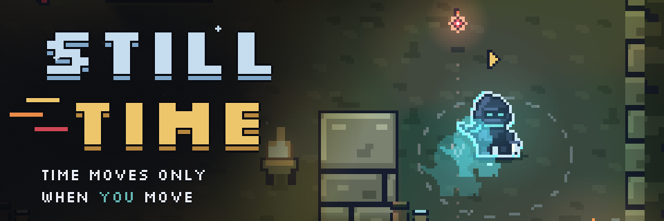
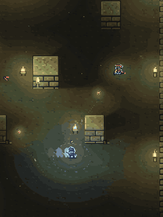
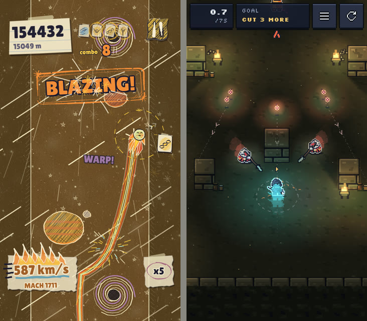
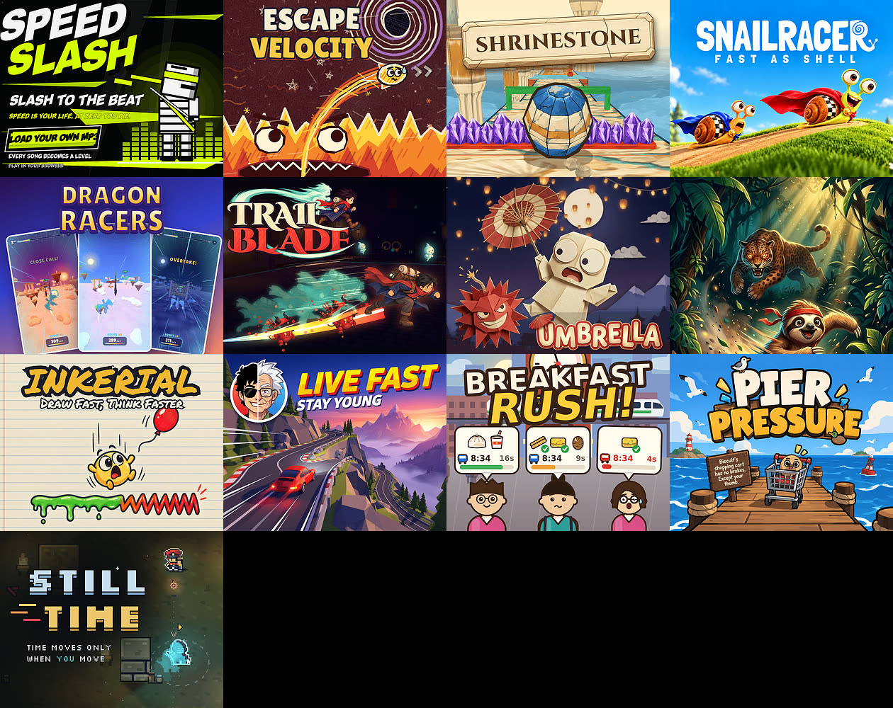

# Still Time



A one-hit assassin game in 30 dungeon rooms. Stand still and the world stops; move and it runs as fast as you do.

**[Play it at still-time.typeonce.games](https://still-time.typeonce.games)** in a browser, on phone or desktop. Made for [Slapjam AI #2](https://itch.io/jam/slapjam-ai-2) ([our entry](https://itch.io/jam/slapjam-ai-2/rate/5270540); the jam build stays [on itch.io](https://sandromaglione.itch.io/still-time)) and built on [Ritmo](https://www.npmjs.com/package/@typeonce/ritmo).



## Result

**41st of 211** ranked entries in Slapjam AI #2 (29 to 31 October 2026, theme Speed, 217 entries). It got 3 ratings ([results](https://itch.io/jam/slapjam-ai-2/results), 7 November 2026).

| Criterion | Average stars (of 5) | Rank |
| --- | --: | --: |
| Fun | 3.333 | 28th |
| Visual Appeal | 3.333 | 39th |
| Theme Following | 3.667 | 63rd |
| Overall | 3.444 | 41st |

## Lessons for the next jam

A panel of about four judges scored Fun, Visual Appeal and Theme Following with equal weight.

The [one comment](https://itch.io/jam/slapjam-ai-2/rate/5270540) on Still Time:

> enemies always shoot at where you were, this becomes boring as the outplay is too easy, maybe shoot-ahead enemies could break the monotony. Sound is a bit too synthetic, would benefit greatly from good sound design.

What the judges wrote about other entries:

| Praised | Marked down |
| --- | --- |
| "the speed is feelable" | "absolutely contradictory to the speed design... boring" (on slow-motion sections) |
| "felt really speedy" | "the game does not make clear what to do... so the fun can begin in the first 20 seconds instead of after 3-5 fails" |
| | "feels a bit too repetitive and easy in the long run once you understood" |
| | "this game is soo hard" |

### 1. Put the surprise in the first minute

**Show the one surprising feature, and the first threat your trick does not beat, in the first 60 seconds; treat everything past room 5 as unjudged.**

- The judge was right: every shooter except the grenadier aims where you are when it fires. Keep moving and the shot is always behind you.
- The threats that break this rhythm (lock-on snipers, the stalker, the clockwork tower) are in later rooms a two-minute judge never reaches.
- Both judge comments on the winner, Speed Slash, named one feature: load your own MP3 and the game builds a level from it.

### 2. Make the theme felt, and show it

**Read the theme as the judges will feel it, and put it on screen as a number.**

Still Time's take on Speed is a world that stops when you stop, and Theme Following was its lowest rank (63rd). The top games show speed as a number (a km/s meter, an m/s meter), where Still Time had only a thin bar under the clock.



*Escape Velocity (left) and Still Time (right), screenshots from their itch pages.*

### 3. Design the cover for the grid

**Design the cover for a 315×250 thumbnail among 200+ entries: bright, a big title, a face.**

The top covers are bright and saturated, and most have a big title and a character's face; Still Time's is dark and muted, with small type. Inside the game too, 5 of the top 6 are 3D or illustrated, and judges at the first Slapjam AI also marked down dark screens.



*The top 12 covers in final order, Still Time's alone on the last row: [Speed Slash](https://megumih.itch.io/speed-slash), [Escape Velocity](https://behlulakdag.itch.io/escape-velocity), [Shrinestone](https://innollia.itch.io/shrinestone), [Snailracer](https://oskariolli.itch.io/snailracer-fast-as-shell), [DragonRacers](https://jeremieagee.itch.io/dragonracers), [TRAILBLADE](https://wakkin.itch.io/trailblade), [Umbrella](https://logheimer.itch.io/umbrella), [Turbo Sloth](https://ragnar18.itch.io/turbo-sloth), [Inkerial](https://erathul.itch.io/inkerial), [Live fast](https://johnhdeleon.itch.io/live-fast), [Breakfast Rush](https://yunhai1.itch.io/breakfast-rush), [Pier Pressure](https://catboxx-studio.itch.io/pier-pressure). Each cover belongs to its game's developers, shown for comparison only.*

### 4. Use real music and designed sound

The judge's second point was "Sound is a bit too synthetic". Still Time's music and sounds were made with ritmo-tools.

### 5. Invisible polish does not score

**Spend jam hours on what a judge sees and feels in two minutes; invisible polish buys nothing.**

Tests, fuzzing, saves, accessibility toggles, keyboard support and the itch page made no difference to the score. The winner's page had one image and 286 words; Still Time's had a GIF, 8 screenshots and a controls strip.

## Run it locally

Built on [Ritmo](https://www.npmjs.com/package/@typeonce/ritmo) (`@typeonce/ritmo`), with pixel art, sound and music made with ritmo-tools. The rules and every room are in [`docs/design.md`](docs/design.md).

```sh
pnpm install
pnpm dev   # http://localhost:5301
```

- Phone: drag to move, let go and time stops, tap to continue.
- Desktop: arrows or WASD to move, space to continue, R to restart, M or Escape for the rooms.

## Release

The game is deployed with [Alchemy](https://alchemy.run/) as a Cloudflare Worker serving the Vite build as static files; saves stay in the player's browser. The separate `deploy/` package keeps its dependencies out of the game, and Cloudflare stores the deployment state.

```sh
pnpm --dir deploy install --frozen-lockfile
pnpm --dir deploy exec alchemy plan --stage prod --profile admin --no-input
pnpm release --profile admin --yes --no-input
```

Release from an up-to-date `main`. `pnpm release` runs `pnpm check` and the deploy typecheck, then builds and deploys the game to <https://still-time.typeonce.games>, creating its DNS record and certificate in the `typeonce.games` zone. Releases run locally; pushing to GitHub does not deploy.

`admin` is the local Alchemy Cloudflare profile. On another machine, use your own profile or set `CLOUDFLARE_ACCOUNT_ID` and `CLOUDFLARE_API_TOKEN` and omit `--profile admin`.

A temporary preview on workers.dev, and its removal:

```sh
pnpm --dir deploy exec alchemy deploy --stage preview --profile admin
pnpm --dir deploy exec alchemy destroy --stage preview --profile admin
```

`pnpm package` still builds the itch.io zip.
